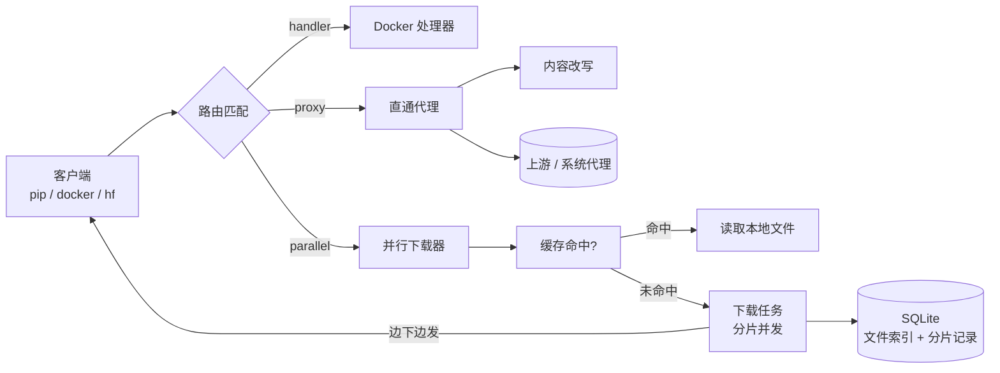

# pacac

> **P**ackage **A**ccelerator & **C**ache —— 一个服务同时加速 PyPI、Docker Hub、HuggingFace、CRAN 以及任意 HTTP 源。
>
> 用 Rust 复刻 [livehl/aimirror](https://github.com/livehl/aimirror)（原版 Python/FastAPI），单文件可执行程序，跨 Windows / Linux / macOS。

---

## 为什么

`pip install torch`、`docker pull nvidia/cuda`、`huggingface-cli download` 都会卡在同一个问题上：**单线程、无缓存、反复下载**。

pacac 做的事情很简单：

- **并行分片下载**：按 HTTP Range 把大文件切成多片并发拉取，榨干带宽；
- **智能缓存**：按 URL 的 SHA-256 落盘，LRU 自动淘汰，二次下载直接命中；
- **动态路由**：小文件走直通代理，大文件自动并行；
- **一个服务多源**：PyPI、Docker Registry、HuggingFace、CRAN 开箱即用，加一条规则就能接入任意 HTTP 源；
- **内容改写**：自动把 HTML/JSON 里的上游链接改写成代理地址，pip 无需额外配置即可走镜像；
- **断点续传**：中断后保留已下载分片，下次接着下；
- **渐进式流式响应**：边下边发，客户端不会因为等待整个文件而超时。

## 特性对比

| | 原版 aimirror (Python) | pacac (Rust) |
|---|---|---|
| 运行时 | Python 3.11 + FastAPI + uvicorn | 单个原生可执行文件，无运行时依赖 |
| 下载 | aiohttp 并行 Range | reqwest + tokio 并行 Range |
| 响应 | 先下载完再返回，或 302 轮询 | **边下边流式返回**，多个客户端共享同一下载任务 |
| 缓存索引 | SQLite | SQLite（WAL） |
| 断点续传 | 有记录但失败会删临时文件 | **保留分片数据**，真正可续传 |
| 查询参数 | 转发时丢弃 | 保留并转发 |
| 系统代理 | 需手写 `upstream_proxy` | 支持 `upstream_proxy: "system"`（Windows 注册表自动读取） |
| 配置兼容 | — | 兼容原版 `config.yaml` 字段 |

## 性能实测

测试对象：`torch-2.9.1+cu126-cp311-cp311-win_amd64.whl`（**2.4 GB**，PyTorch CDN）与 `torch-2.14.1-cp311-cp311-win_amd64.whl`（118 MB，PyPI）。
环境：Windows 11 / 千兆家宽 / 本地代理 `127.0.0.1:10808`。该链路本身抖动很大（同一配置多次测量可差 5–10 倍），下表取同批次对照。

**核心结论：分片并行有没有用，取决于上游是否「按连接限速」。**

| 源 | 1 连接 | 8 连接并行 | 结论 |
|---|---|---|---|
| PyTorch CDN（download-r2.pytorch.org）经代理 | 4.8 MB/s | **10.8–12.2 MB/s** | **2.3–2.5x，分片有效** |
| PyPI（files.pythonhosted.org） | 13.6–14.5 MB/s | 13.7 MB/s | 单连接已打满线路，分片无效 |
| 国内清华镜像 | 12.9–14.4 MB/s | 6.3 MB/s | 总带宽到顶，分片反而更慢 |

对 `pip install torch`（CUDA 版 2.4 GB，来自 PyTorch CDN）：

| 方式 | 速度 | 耗时 |
|---|---|---|
| pip 直接装（单连接） | 4.8 MB/s | ~8.5 分钟 |
| **pip + pacac（`-j 8`）** | **10.8–12.2 MB/s** | **~3.5 分钟** |
| pip + pacac 第二次（缓存命中） | 76–94 MB/s | **~30 秒** |

> pip / uv / pixi 都是「一个文件一个连接」，拿不到按连接限速的上游的额外带宽；pacac 把单文件切成多段并发，这才是它相对包管理器的增量。

其它结论：

- **缓存命中是最大收益**：本地磁盘 76–94 MB/s，反复装、多机、Docker/CI 场景差别最大；
- **分片大小影响不大**（5 MB 与 16 MB 实测相同），`chunk_size: 0` 的自动模式留给 GB 级 Docker 层；
- **`--http2`**：默认每个分片独占一条连接（HTTP/1.1），这样才能突破按连接限速；如果上游不按连接限速（例如 PyPI），加 `--http2` 让分片复用到一条连接上，开销更小。

> 复现命令：`pacac --lan -j 8`，然后 `curl -o NUL http://127.0.0.1:8081/torch-r2/whl/cu126/torch-*.whl`。

## 快速开始

### 方式一：直接运行（使用内置配置）

```powershell
.\pacac.exe                       # 只监听 127.0.0.1:8081
.\pacac.exe --lan                 # 局域网可访问，自动使用本机局域网 IP
.\pacac.exe --lan --proxy system  # 局域网 + 走系统代理
```

```bash
# Linux / macOS
./pacac --lan
```

首次运行会：

1. 在 `./config.yaml`、可执行文件同级目录、用户配置目录中依次寻找配置文件；
2. 都找不到时使用**内置默认配置**（等价于仓库里的 `config.yaml`）；
3. 把缓存写到平台缓存目录：
   - Windows：`%LOCALAPPDATA%\pacac\cache`
   - macOS：`~/Library/Caches/pacac`
   - Linux：`~/.cache/pacac`

启动后会打印横幅，直接给出可复制的接入命令：

```
  pacac 0.1.0  -  Package Accelerator & Cache
  ================================================================
  listen     0.0.0.0:8081  (LAN 192.168.1.10)
  public     http://192.168.1.10:8081
  upstream   system proxy (http://127.0.0.1:7890)
  downloads  20 chunks/file, 100 files at once, 5.0 MB chunks
  cache      C:\Users\me\AppData\Local\pacac\cache  (100.0 GB, LRU)
  rules      12 (pypi-simple, pypi-metadata, pypi-packages, ...)

  pip        pip install -i http://192.168.1.10:8081/simple --trusted-host 192.168.1.10:8081 <package>
  hf         HF_ENDPOINT=http://192.168.1.10:8081
  docker     "registry-mirrors": ["http://192.168.1.10:8081"]
  health     http://192.168.1.10:8081/health
```

健康检查与统计：

```bash
curl http://127.0.0.1:8081/health
curl http://127.0.0.1:8081/stats
```

### 方式二：指定配置文件

```powershell
.\pacac.exe --config .\config.yaml
```

### 方式三：从源码编译

```bash
git clone <this repo>
cd pacac
cargo build --release
# 产物：target/release/pacac(.exe)
```

> 需要 Rust 1.82+。首次编译会编译 SQLite 与 rustls 的 C 代码，需要本机有 C 编译器（Windows 上是 MSVC Build Tools）。

### 命令行参数

所有参数都覆盖配置文件中的同名设置；不写配置文件也能完整启动。

**网络**

| 参数 | 说明 |
|---|---|
| `-p, --port <PORT>` | 监听端口（`PACAC_PORT`） |
| `--lan` | 允许局域网访问，绑定 `0.0.0.0`，并自动用本机局域网 IP 作为对外地址 |
| `--local-only` | 只允许本机访问，绑定 `127.0.0.1`（默认） |
| `--host <ADDR>` | 直接指定监听地址，优先级高于 `--lan/--local-only` |
| `--public-host <HOST:PORT>` | 客户端访问本服务用的地址（链接改写、Docker 认证用） |

**上游代理**

| 参数 | 说明 |
|---|---|
| `--proxy <URL>` | 上游代理，如 `--proxy http://127.0.0.1:7890`（省略协议自动补 `http://`） |
| `--proxy system` | 使用操作系统代理（Windows 读注册表，其它平台读环境变量） |
| `--proxy none` | 强制直连 |
| `--no-proxy` | 强制直连（等价于 `--proxy none`） |

**下载**

| 参数 | 说明 |
|---|---|
| `-j, --concurrency <N>` | **单个文件**的分片并行数，覆盖所有 `parallel` 规则 |
| `--chunk-size <SIZE>` | 每个分片的字节数，支持 `5MB` / `512k` / `1048576` / `0`（自动） |
| `--max-downloads <N>` | **同时下载的文件数**上限，超出排队，等待超时返回 503 |
| `--sequential <N>` | `chunk_size: 0`（自动分片）模式下的并发下载数 |
| `--http2` | 分片请求复用 HTTP/2 单连接（默认每个分片独占连接；上游不按连接限速时可开） |

**缓存与其它**

| 参数 | 说明 |
|---|---|
| `--cache-dir <DIR>` | 缓存目录 |
| `--cache-size <GB>` | 缓存上限（GiB），超出按 LRU 淘汰 |
| `--no-cache` | 不读不写缓存，纯流式转发 |
| `-c, --config <PATH>` | 配置文件路径（`PACAC_CONFIG`） |
| `--log-level <LEVEL>` | `trace`/`debug`/`info`/`warn`/`error`（`PACAC_LOG_LEVEL`） |
| `-v, --verbose` | 等价于 `--log-level debug` |
| `-q, --quiet` | 只输出警告和错误，不打印启动横幅 |
| `--check-config` | 校验配置后退出 |
| `--print-config` | 打印最终生效的配置（含命令行覆盖）后退出 |

示例：

```powershell
# 本机使用，端口 8081
pacac

# 局域网共享 + 走系统代理 + 每个文件 32 分片 + 同时下 200 个文件
pacac --lan --proxy system -j 32 --max-downloads 200

# 不用配置文件，纯命令行：端口 9000、8MB 分片、50GB 缓存、关闭缓存落盘
pacac -p 9000 --chunk-size 8MB --cache-size 50

# 只校验一份配置
pacac -c .\my.yaml --check-config
```

用 `-q` 可以隐藏横幅和普通日志；`--print-config` 会把命令行覆盖后的最终配置打印出来。

## 客户端配置

### pip / uv

```bash
# 全局配置
pip config set global.index-url http://127.0.0.1:8081/simple
pip config set global.trusted-host 127.0.0.1

# 或单次使用
pip install torch --index-url http://127.0.0.1:8081/simple --trusted-host 127.0.0.1

# uv
uv pip install torch --index-url http://127.0.0.1:8081/simple
```

也可以直接把 pacac 当 HTTPS 代理用（pip 的所有请求都会经过它）：

```powershell
$env:HTTPS_PROXY = "http://127.0.0.1:8081"
pip install torch
```

### Docker

```json
// /etc/docker/daemon.json
{
  "registry-mirrors": ["http://127.0.0.1:8081"]
}
```

> Docker 镜像层通常有 GB 级，`docker-blob` 规则使用 `chunk_size: 0`（自动分片），把文件切成 `concurrency - 10` 等份，避免分片过多导致 token 过期。

### HuggingFace

```powershell
$env:HF_ENDPOINT = "http://127.0.0.1:8081"
huggingface-cli download gpt2 --local-dir .\gpt2
```

```python
import os
os.environ["HF_ENDPOINT"] = "http://127.0.0.1:8081"
from huggingface_hub import snapshot_download
snapshot_download("gpt2")
```

### R / CRAN

```r
options(repos = c(CRAN = "http://127.0.0.1:8081"))
```

### conda

```yaml
# ~/.condarc
channels:
  - http://127.0.0.1:8081/conda-forge
```

### npm / maven / 其它

任何 HTTP 源都可以通过 `rules` 接入，例如 GitHub Releases：

```yaml
rules:
  - name: github-releases
    pattern: '/.*/releases/download/.+'
    upstream: "https://github.com"
    strategy: parallel
    min_size: 1048576
    concurrency: 16
    chunk_size: 10485760
```

## 配置说明

完整示例见仓库根目录的 [`config.yaml`](config.yaml)。

### server

| 字段 | 说明 | 默认值 |
|---|---|---|
| `host` | 监听地址（`--lan` 等价于 `0.0.0.0`） | `"127.0.0.1"` |
| `port` | 监听端口 | `8081` |
| `upstream_proxy` | 上游代理；空 = 直连，`"system"` = 读取系统代理 | `""` |
| `public_host` | 客户端访问本服务的地址，用于链接改写与 Docker 认证 | `127.0.0.1:<port>` |
| `max_concurrent_downloads` | 全局同时下载的文件数 | `100` |
| `sequential_downloads` | `chunk_size: 0` 规则的并发数 | `1` |
| `queue_timeout_secs` | 等待下载槽位的超时，超时返回 503 | `15` |

### cache

| 字段 | 说明 | 默认值 |
|---|---|---|
| `dir` | 缓存目录（相对路径按配置文件所在目录解析，支持 `~` 与 `%VAR%`） | 平台缓存目录 |
| `enabled` | `false` 等同于 `--no-cache`，不读不写 | `true` |
| `max_size_gb` | 缓存上限 | `100` |
| `lru_enabled` | 超限时按最近访问时间淘汰 | `true` |
| `chunk_ttl_hours` | 断点续传记录有效期 | `48` |

### rules

| 字段 | 说明 |
|---|---|
| `name` | 规则名（`docker-registry` 会被 Docker 处理器使用） |
| `upstream` | 上游 base URL |
| `strategy` | `proxy` 直通 / `parallel` 并行分片 |
| `pattern` | 正则匹配路径（search 语义） |
| `path_prefix` | 前缀匹配（要求路径边界，`/simple` 不会匹配 `/simplex`） |
| `strip_prefix` | 拼接上游时去掉匹配到的前缀 |
| `path_rewrite` | 额外的路径字面量替换，如 `/blob/` → `/resolve/` |
| `min_size` | 小于该字节数时退回直通代理 |
| `concurrency` | 并行分片数 |
| `chunk_size` | 分片大小；`<= 0` 表示自动（总大小 / (concurrency - 10)） |
| `cache_key_source` | `final`（跟随重定向后的 URL）/ `original`（客户端请求的 URL） |
| `handler` | 特殊处理器，目前支持 `handlers.docker` |
| `head_meta_headers` | HEAD 请求时需要保留的响应头（HuggingFace 元数据） |

### content_rewrite

全局响应改写：命中的 Content-Type 里，把所有 `targets` 中的 host 替换为 `http://<public_host>`。

```yaml
content_rewrite:
  content_types: ["text/html", "application/json", "application/vnd.pypi.simple"]
  targets:
    - "https://files.pythonhosted.org"
    - "https://pypi.org"
```

### logging

| 字段 | 说明 |
|---|---|
| `level` | `trace` / `debug` / `info` / `warn` / `error` |
| `file` | 可选日志文件路径（同时输出到控制台） |
| `ansi` | 是否彩色输出（默认自动判断） |

## 工作原理



一次并行下载的流程：

1. `HEAD` 上游拿到文件大小、Content-Type 和最终 URL；
2. 用缓存键（默认是最终 URL）查索引，命中直接读本地文件返回；
3. 未命中时检查是否有同名下载任务：有则**挂到同一个任务**，多个客户端共享一次下载；
4. 没有则申请全局下载槽位，预分配临时文件，按 `chunk_size` 切分并并发发起 Range 请求；
5. 每个分片写盘并 `flush` 后才把该区间标记为「可用」，读取端只发送连续可用区间 —— 保证客户端拿到的每个字节都是真实的；
6. 下载完成校验总大小后，硬链接进缓存目录（失败则复制）、写入索引、清理分片记录，并执行 LRU 淘汰。

## 管理端点

| 路径 | 说明 |
|---|---|
| `GET /health` | `status`、`active_downloads`、`downloads`、`in_flight`（含进度）、`cache_hits/misses`、`uptime_seconds` |
| `GET /stats` | 缓存条目数、总大小、首次写入时间、最近访问时间 |

```bash
curl -s http://127.0.0.1:8081/health | jq
curl -s http://127.0.0.1:8081/stats | jq
```

## 与 Python 原版的差异

保持配置兼容的同时，有几处刻意的行为改进：

1. **流式返回**：原版在下载完成后才返回（或用 302 + 长轮询让客户端重试）；pacac 边下边发，首个字节延迟从「整个文件」降到「第一个分片」。
2. **多客户端共享**：同一文件的并发请求会挂到同一个下载任务上，不再各自下载。
3. **查询参数保留**：原版 `target_url = upstream + path` 会丢掉 `?query`，pacac 会保留。
4. **前缀匹配加边界**：`/simple` 不再误匹配 `/simplex`。
5. **真正的断点续传**：分片写盘后立即记录，失败不删除临时文件（重启后校验大小一致才复用）。
6. **503 背压**：下载槽位耗尽时返回 `503 + Retry-After`，而不是 302 到自身。
7. **新增配置项**：`cache.enabled`、`sequential_downloads`、`queue_timeout_secs`、`upstream_proxy: "system"`、`logging.ansi`。
8. **默认只监听本机**：原版默认 `0.0.0.0`；pacac 默认 `127.0.0.1`，需要共享时加 `--lan`（并自动用局域网 IP 作为对外地址）。
9. **纯命令行可用**：所有关键参数都能用启动参数覆盖，不写配置文件也能跑；启动横幅直接给出 pip / HF / Docker 的接入命令。
10. **缓存索引不兼容**：SQLite 表结构与原版不同（原版 `meta.db` 不会被读取），换用 pacac 后首次会重新缓存。

## 常见问题

**Windows 第一次启动弹出防火墙提示？**
只有 `--lan`（或 `host: "0.0.0.0"`）时才会监听所有网卡并触发防火墙提示；默认只听 `127.0.0.1`，不会弹窗。

**下载很慢 / 全部超时？**
先确认机器本身能访问上游。若浏览器能上网而 pacac 不能，说明走的是系统代理：把 `upstream_proxy` 设为 `"system"` 或填写代理地址（如 `"http://127.0.0.1:7890"`）。

**pip 报 `Certificate verification failed`？**
通过 HTTP 访问需要 `--trusted-host`，或把 `index-url` 换成 HTTPS 并由反向代理终止 TLS。

**缓存占满磁盘？**
`cache.max_size_gb` 控制上限，超过后按最近访问时间淘汰。想立即清理可直接停止服务后删除缓存目录。

**端口被占用？**
`--port 8082` 或修改 `server.port`；同时记得更新 `public_host`，否则改写后的链接仍指向旧端口。

**为什么 Docker 拉取时 `chunk_size` 是 0？**
自动模式把文件切成 `concurrency - 10` 份，分片更少、请求更少，降低 registry token 在长时间下载中过期的概率。

## 开发

```bash
cargo test          # 70 个测试：单元 + 端到端（真实 HTTP 上下游）
cargo clippy --all-targets
cargo fmt
cargo run -- --check-config
```

目录结构：

```
src/
  main.rs         CLI、日志初始化
  config.rs       配置模型、路径解析、校验、发现顺序
  router.rs       规则匹配、路径重写、上游 URL 拼接
  cache.rs        SQLite 索引、LRU、分片记录、临时文件清理
  downloader.rs   并行 Range 下载、渐进式流式读取
  proxy.rs        直通代理、内容改写、文件响应
  server.rs       路由分发、下载编排、/health、/stats、信号处理
  handlers/
    docker.rs     Docker Registry v2 认证与 library 重定向
  sysproxy.rs     系统代理探测（Windows 注册表 / 环境变量）
tests/
  integration.rs  端到端：代理、改写、并行、缓存、Docker、续传、背压
  streaming.rs    流式返回不出现空洞的回归测试
```

### 跨平台构建

`.github/workflows/` 中提供了：

- `ci.yml`：Windows / Linux / macOS 三平台跑 `fmt`、`clippy`、`test`；
- `release.yml`：打 tag 时构建三平台产物并发布到 GitHub Release。

本地交叉编译（可选）：`cargo zigbuild --target x86_64-unknown-linux-musl`。

## 路线图

- [ ] Windows 服务安装（`pacac install-service`）
- [ ] 缓存命中率 / 流量统计持久化
- [ ] 按规则覆盖缓存 TTL
- [ ] Web 控制台（查看缓存、清理、实时下载）

## License

MIT，基于 [livehl/aimirror](https://github.com/livehl/aimirror) 的设计与配置格式。
